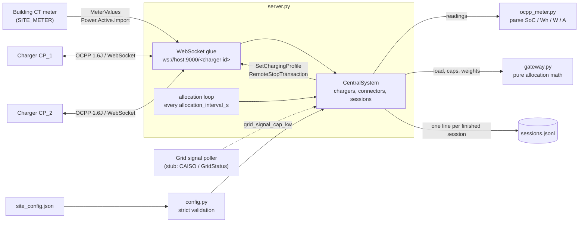

# edge-ocpp-router

An OCPP 1.6J central system that shares a building's spare electrical capacity among
EV chargers. Every cycle (2 s by default), it measures how much power the building
leaves free and decides each car's share. It then pushes that share to the charger
as a `SetChargingProfile`.

Built for sites where the panel is the constraint: commercial buildings, parking lots,
fleet depots, and landlord/HOA buildings.

## Architecture



| File | Role |
|---|---|
| `server.py` | `CentralSystem` (all logic, no sockets) plus the WebSocket glue, allocation loop and grid poller. |
| `gateway.py` | Pure math: EV budget, priority weights, capped weighted split, charging-profile messages. |
| `ocpp_meter.py` | Reads `meterValue → sampledValue` (and simple `{"soc": ..}` JSON) into fixed units. |
| `config.py` | Loads and strictly validates `site_config.json`. |
| `sim_chargers.py` | Simulated chargers (with battery physics) and a simulated building CT meter. |

## Quick start

```bash
python3 -m venv venv
venv/bin/pip install -r requirements-dev.txt

# terminal 1
venv/bin/python server.py

# terminal 2
venv/bin/python sim_chargers.py
```

With the simulator's 470 kW building load, the EV budget is 600 − 470 − 120 = 10 kW:

```
[CP_1 | 22.0% SoC] Received limit: 6666.0 W
[CP_2 | 67.0% SoC] Received limit: 3333.0 W
```

Between **16:00 and 21:00 site time** (the PG&E peak window), the budget is capped at
`peak_budget_cap_kw` (6.0 kW). During that window, you will see 4000 W / 2000 W instead.

Run the tests (no internet needed; the end-to-end tests use loopback only):

```bash
venv/bin/pytest -q
```

### Simulator options

| Option | Effect |
|---|---|
| `--cars CP_1:22,CP_2:67,CP_3:none` | Chargers and starting SoC. `none` = a J1772 car that reports no SoC (weighted by kWh delivered). |
| `--reject-tx CP_2` | CP_2 rejects TxProfile, so the server falls back to ChargePointMaxProfile. |
| `--reject-all CP_2` | CP_2 rejects every profile, so the server sends RemoteStopTransaction and raises a CRITICAL alert. |
| `--ct-dropout-after 10` | The CT meter goes silent after 10 s; 15 s later the budget drops to the 2.0 kW floor. |
| `--time-scale 600 --battery-kwh 5` | Speeds up charging to watch cars fill up and taper off. |
| `--building-load-kw 470` | The building load the CT meter reports. |

## How a cycle decides power

1. **Building budget** = `panel_limit_kw − building load − safety_margin_kw`, never negative.
   The load comes from the CT meter, which connects like a charger at `/<site_meter_id>`
   and sends `MeterValues` on connector 0 with `Power.Active.Import`.
2. **Stale telemetry.** If there has been no CT reading yet, or the last one is older
   than `stale_after_s` (15 s), the budget is held at `stale_floor_kw` (2.0 kW). That is
   neither 0 W, which can fault EVs, nor full power, which can trip breakers.
3. **Caps.** A live grid signal (`grid_signal_cap_kw`, no older than `max_age_s`) caps
   the budget. Without one (offline), the tariff `peak_windows` apply with
   `peak_budget_cap_kw`. The lower of the budget and the cap is used.
4. **Reserved power.** A charger that disconnects mid-session keeps its last limit
   reserved, because its profile is still in force on the charger. That lasts until it
   reconnects or `offline_session_timeout_s` passes. A charger that refused every
   limit has `max_charger_kw` reserved until its transaction stops.
5. **Priority.** If the car reports SoC: below 30 % → 3.0, below 80 % → 1.5, below 100 %
   → 0.5, full → 0. If it reports no SoC: kWh delivered this session below 10 → 3.0,
   10–30 → 1.5, above 30 → 0.5.
6. **Split.** The budget is shared by weight. No car gets more than `max_charger_kw`,
   and any excess is redistributed. A share below `min_charger_kw` becomes 0 W and its
   power goes to the others. Shares are rounded down to whole watts, so the total never
   exceeds the budget.
7. **Taper reclaim.** A car that has been allowed to charge for `taper_grace_s` but
   draws under `taper_threshold_w` is capped at `min_charger_kw`. The freed power goes
   to the other cars, and the car gets its full share back as soon as it draws again.

## Sending limits, and what happens when a charger refuses

* A car with a transaction gets a **TxProfile** (with its `transactionId`). A car without
  a transaction gets a **TxDefaultProfile**. Limits are re-sent only when they change, or
  every `profile_refresh_s`.
* **Rejected** (or `NotSupported`, or a CALLERROR): the server retries once with a
  **ChargePointMaxProfile** (connector 0, stackLevel 0, Absolute). If it is accepted, that
  charger is limited through ChargePointMax from then on, until it reboots.
* **Still rejected**: the server sends **RemoteStopTransaction** and logs a `CRITICAL ALERT`.
  If there is no transaction to stop, or the stop is refused, the alert says manual
  intervention is required.
* **No answer** within `call_timeout_s` is not treated as a refusal. The limit is retried
  next cycle. A charger that is truly gone is detected by the WebSocket ping and handled
  as offline.

## Sessions

A session runs from plug-in (`StatusNotification` Preparing/Charging/SuspendedEV/
SuspendedEVSE, `StartTransaction`, a first SoC reading, or `MeterValues` for a running
transaction it had not seen) to unplug (`Available`). For
each session, the server tracks plug-in time, duration, transaction start/stop,
kWh delivered (from `meterStart`/`Energy.Active.Import.Register`/`meterStop`) and start
and end SoC. Each finished session is appended as one JSON line to `session_log_path`.

## Configuration (`site_config.json`)

Every key is required. An unknown key, a wrong type or an out-of-range value stops the
server at startup with a message naming the key.

| Key | Default | Meaning |
|---|---|---|
| `site.panel_limit_kw` | 600.0 | Most the whole building may draw. |
| `site.safety_margin_kw` | 120.0 | Kept free below the limit (usable: 480 kW). |
| `site.site_meter_id` | `SITE_METER` | Connection id of the building CT meter. |
| `site.timezone` | `America/Los_Angeles` | Site time for the peak windows (DST handled). |
| `chargers.max_charger_kw` | 10.0 | Most one car may get. |
| `chargers.min_charger_kw` | 1.4 | Smallest power a charger can regulate (~6 A); below it, 0 W. |
| `chargers.taper_threshold_w` | 100.0 | Below this measured draw, a car counts as tapered. |
| `chargers.taper_grace_s` | 30.0 | Ramp-up time before a car can count as tapered. |
| `chargers.offline_session_timeout_s` | 300.0 | How long an offline charger's limit stays reserved. |
| `telemetry.stale_after_s` | 15.0 | CT reading age after which the budget drops to the floor. |
| `telemetry.stale_floor_kw` | 2.0 | Total EV budget on stale telemetry (~8.3 A at 240 V). |
| `tariff.peak_windows` | 16:00–21:00 | Daily windows, site time; `end` < `start` wraps past midnight. |
| `tariff.peak_budget_cap_kw` | 6.0 | EV budget cap inside a peak window. |
| `grid_signal.enabled` | false | Run the grid signal poller. |
| `grid_signal.poll_interval_s` | 60.0 | Seconds between polls. |
| `grid_signal.max_age_s` | 300.0 | Older signals are ignored (tariff windows apply). |
| `server.host` / `server.port` | localhost / 9000 | Where the server listens. |
| `server.allocation_interval_s` | 2.0 | Seconds between allocation cycles. |
| `server.profile_refresh_s` | 30.0 | Re-send an unchanged limit this often. |
| `server.call_timeout_s` | 10.0 | Wait this long for a charger's reply. |
| `server.session_log_path` | `sessions.jsonl` | Finished-session log (relative to the config file); `null` to disable. |

## Assumptions and limits

* **The CT meter measures building load without the EV chargers.** If your CT also
  measures the chargers, the EV draw would be counted twice.
* **The grid signal poller is a stub.** It makes no network call and reports "no signal",
  so the tariff windows apply. To use a real signal, give `grid_signal_poller` an async
  `fetch` that returns a cap in kW (or `None`), or construct `CentralSystem` with
  `grid_signal_cap_kw=`.
* **Every `idTag` is accepted.** Driver authorization is outside this router's scope.
* **Limits are sent in watts** (`chargingRateUnit: "W"`). Some AC chargers only accept
  amps. Such a charger would reject the profile, which triggers the fallback and
  escalation path above.
* **State is in memory and the server is a single process.** After a restart, running
  transactions are adopted from the chargers' next `MeterValues` (OCPP chargers include
  the `transactionId`), and new plug-ins are picked up from `StatusNotification`.
