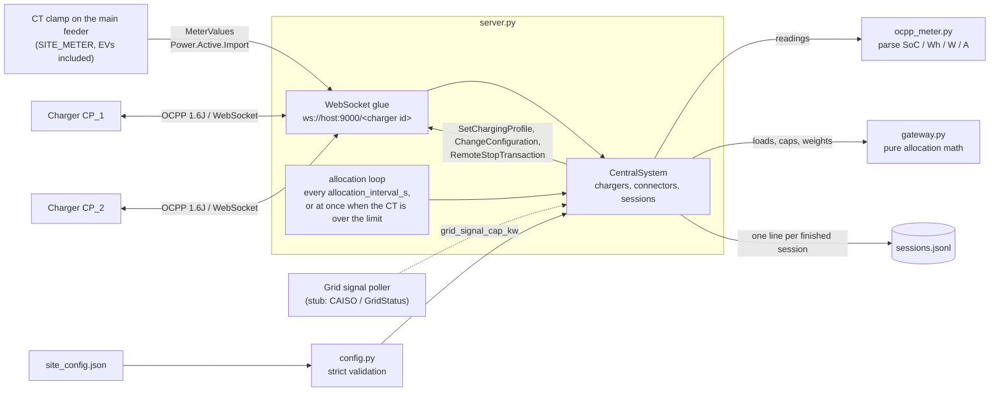

# edge-ocpp-router

An OCPP 1.6J central system that shares a building's spare electrical capacity among
EV chargers. A CT clamp on the main incoming feeder measures the whole site. From
that reading, the server works out what everything *other* than the EVs is drawing.
It then gives the EVs what is left, by priority, as `SetChargingProfile` limits. Cuts
go out immediately, and it never hands out power that a car might still be using.

Built for sites where the panel is the constraint: commercial buildings, parking lots,
fleet depots, and landlord/HOA buildings.

## Architecture



| File | Role |
|---|---|
| `server.py` | `CentralSystem` (all logic, no sockets) plus the WebSocket glue, allocation loop and grid poller. |
| `gateway.py` | Pure math: other-load estimate, EV budget, priority weights, capped weighted split, transition-safe limits, charging-profile messages. |
| `ocpp_meter.py` | Reads `meterValue → sampledValue` (and simple `{"soc": ..}` JSON) into fixed units. |
| `config.py` | Loads and strictly validates `site_config.json`. |
| `sim_chargers.py` | Simulated chargers (with battery physics) and a simulated main-feeder CT clamp. |

## Quick start

```bash
python3 -m venv venv
venv/bin/pip install -r requirements-dev.txt

# terminal 1
venv/bin/python server.py

# terminal 2
venv/bin/python sim_chargers.py
```

The simulator's other loads are 470 kW, so the EV budget is 600 − 470 − 120 = 10 kW:

```
[CP_1 | 22.0% SoC] Received limit: 6666.0 W
[CP_2 | 67.0% SoC] Received limit: 3333.0 W
```

Between **16:00 and 21:00 site time** (the PG&E peak window), the budget is capped at
`peak_budget_cap_kw` (5.0 kW). During that window, you will see 3333 W / 1666 W instead.

Run the tests (no internet needed; the end-to-end tests use loopback only):

```bash
venv/bin/pytest -q
```

### Simulator options

| Option | Effect |
|---|---|
| `--cars CP_1:22,CP_2:67,CP_3:none` | Chargers and starting SoC. `none` = a J1772 car that reports no SoC (weighted by kWh delivered). |
| `--building-load-kw 470` | The site's other loads. The simulated CT reports these **plus** what the cars draw. |
| `--ct-interval 1` | Seconds between CT readings. |
| `--reject-tx CP_2` | CP_2 rejects TxProfile, so the server falls back to ChargePointMaxProfile. |
| `--reject-all CP_2` | CP_2 rejects every profile, so the server sends RemoteStopTransaction and raises a CRITICAL alert. |
| `--ct-dropout-after 10` | The CT goes silent after 10 s; 15 s later the budget drops to the 2.0 kW floor. |
| `--time-scale 600 --battery-kwh 5` | Speeds up charging to watch cars fill up and taper off. |

## How a cycle decides power

1. **Measure the other loads.** The CT clamp on the main feeder measures the whole site,
   **EVs included**. So: *other loads = CT reading − what the EVs drew at that instant*.
   The CT and the chargers report at different moments, so each car's draw is paired
   with the CT reading by time. Every uncertainty is resolved toward **under-counting**
   the EVs, which over-counts the other loads and gives a smaller EV budget:
   * The car's last power reading at or before the CT reading is used. With none, the
     car counts as 0, because a car that only started afterwards is not in that reading.
   * A lower reading just afterwards is used instead (the car may have stopped by
     itself), unless a new limit was accepted in between. In that case the drop is the
     server's own cut, which the CT reading predates.
   * The value is capped by the limit in force at that instant. A car still ramping down
     after a cut only counts its new limit. With no known limit, it is capped at
     `max_charger_kw`, so a garbage value such as 1e9 W can't wipe out the other loads.
   * A car whose charger reports SuspendedEV/SuspendedEVSE counts as 0.
   * The result is rounded **up** to whole watts.
2. **Building budget** = `panel_limit_kw − other loads − safety_margin_kw`, never negative,
   rounded **down** to whole watts.
3. **Bad CT data.**
   * No reading yet, or one older than `stale_after_s` (15 s): the budget is held at
     `stale_floor_kw` (2.0 kW). That is neither 0 W, which can fault EVs, nor full power,
     which can trip breakers.
   * A **negative** reading means the clamp is installed backwards (or the site is
     exporting). Trusting it would hand the EVs the whole panel, so the budget is 0 and a
     CRITICAL alert is logged.
4. **Caps.** A live grid signal (`grid_signal_cap_kw`, no older than `max_age_s`) caps
   the budget. Without one (offline), the tariff `peak_windows` apply with
   `peak_budget_cap_kw`. The lower of the budget and the cap is used.
5. **Reserved power.** A charger that disconnects mid-session keeps its last limit
   reserved, because its profile is still in force on the charger. That lasts until it
   reconnects or `offline_session_timeout_s` passes. A charger that refused every limit
   has `max_charger_kw` reserved until its transaction stops.
6. **Priority.** If the car reports SoC: below 30 % → 3.0, below 80 % → 1.5, below 100 % →
   0.5, full → 0. If it reports no SoC: kWh delivered this session below 10 → 3.0,
   10–30 → 1.5, above 30 → 0.5.
7. **Split.** The budget is shared by weight in **exact integer watts**. Weights are
   Python `Fraction`s, so no binary floating-point error enters a share, and every share
   is rounded down. No car gets more than `max_charger_kw`, and any excess is
   redistributed. A share below `min_charger_kw` becomes 0 W and its power goes to the
   others, lowest priority first. Between equal weights it is first come, first served:
   the car that plugged in first keeps charging, and the choice does not flip between
   cycles.
8. **Taper reclaim.** A car that has been allowed to charge for `taper_grace_s` but
   draws under `taper_threshold_w` is capped at `min_charger_kw`. The freed power goes
   to the other cars, and the car gets its full share back as soon as it draws again.

## Throttling sharply without tripping a breaker

* **Cuts are immediate.** A decrease of even 1 W is sent on the cycle it is computed, to
  all chargers in parallel, with no deadband and no hysteresis. A charger still
  answering a previous message gets it on the next cycle. Meanwhile, its old limit stays
  counted as committed.
* **Raises only from real headroom.** A charger only lowers its draw once it has
  accepted a new limit. Until then, each car is counted at its *committed* power: its
  accepted limit, any higher limit still in flight, or one that was sent and never
  answered. An unknown car counts as `max_charger_kw`. Raises are granted, highest
  priority first, only from headroom that exists while every car still draws its
  committed power. Moving power from car A to car B therefore takes two cycles: A's
  cut, then B's raise once A has confirmed. At no point can the worst case exceed the
  budget. The tests check this property over 20,000 random situations and through
  300 cycles of a busy site.
* **No waiting when the site is over.** A CT reading above `panel_limit_kw −
  safety_margin_kw` starts a cycle immediately instead of waiting for the next one.
  In the end-to-end test, with random load jumps, the longest time over the limit was
  one CT sample plus one round trip (under 0.1 s).
* **Less network chatter, safely.** A raise smaller than `min_increase_w` (100 W) is not
  sent, because holding the lower value is always safe. Cuts are never held back.
  Unchanged limits are refreshed every `profile_refresh_s` (30 s).
* **Fresh readings.** After each boot, the server sets the charger's
  `MeterValueSampleInterval` and `MeterValuesSampledData` (standard OCPP 1.6 keys), so
  power readings arrive often enough to pair with the CT. If a charger cannot sample
  SoC, the server asks again without it.
* **One message at a time.** Each charger has at most one of the server's CALLs
  outstanding, as OCPP-J requires.

## Sending limits, and what happens when a charger refuses

* A car with a transaction gets a **TxProfile** (with its `transactionId`). A car without
  a transaction gets a **TxDefaultProfile**. Limits are whole watts, rounded down.
* **Rejected** (or `NotSupported`, or a CALLERROR): the server retries once with a
  **ChargePointMaxProfile** (connector 0, stackLevel 0, Absolute). If it is accepted, that
  charger is limited through ChargePointMax from then on, until it reboots.
* **Still rejected**: the server sends **RemoteStopTransaction** and logs a `CRITICAL ALERT`.
  If there is no transaction to stop, or the stop is refused, the alert says manual
  intervention is required.
* **No answer** within `call_timeout_s` is not treated as a refusal. The limit is retried
  next cycle, and is counted as possibly in force in the meantime.
* **Accepted but ignored.** A charger that accepts a limit but still draws more than it
  10 s later (SAE J1772 gives the car 5 s to follow) is logged as an error once. The site
  stays protected, because its excess shows up in the CT reading as other load.

## Sessions

A session runs from plug-in to unplug (`Available`). Plug-in is detected from
`StatusNotification` Preparing/Charging/SuspendedEV/SuspendedEVSE, `StartTransaction`, a
first SoC reading, or `MeterValues` for a running transaction the server had not seen.
For each session, the server tracks plug-in time, duration, transaction start/stop,
kWh delivered (from `meterStart`/`Energy.Active.Import.Register`/`meterStop`) and start
and end SoC. Each finished session is appended as one JSON line to `session_log_path`.

## Configuration (`site_config.json`)

Every key is required. An unknown key, a wrong type or an out-of-range value stops the
server at startup with a message naming the key.

| Key | Default | Meaning |
|---|---|---|
| `site.panel_limit_kw` | 600.0 | Most the whole site may draw **continuously** (see the codes below). |
| `site.safety_margin_kw` | 120.0 | Kept free below the limit (usable: 480 kW). |
| `site.site_meter_id` | `SITE_METER` | Connection id of the main-feeder CT meter. |
| `site.timezone` | `America/Los_Angeles` | Site time for the peak windows (DST handled). |
| `chargers.max_charger_kw` | 10.0 | Most one car may get. |
| `chargers.min_charger_kw` | 1.44 | Smallest limit sent other than 0: 6 A at 240 V (6.9 A at 208 V). |
| `chargers.min_increase_w` | 100.0 | Raises smaller than this are not sent (cuts always are). |
| `chargers.taper_threshold_w` | 100.0 | Below this measured draw, a car counts as tapered. |
| `chargers.taper_grace_s` | 30.0 | Ramp-up time before a car can count as tapered. |
| `chargers.offline_session_timeout_s` | 300.0 | How long an offline charger's limit stays reserved. |
| `telemetry.stale_after_s` | 15.0 | CT reading age after which the budget drops to the floor. |
| `telemetry.stale_floor_kw` | 2.0 | Total EV budget on stale telemetry (~8.3 A at 240 V). |
| `tariff.peak_windows` | 16:00–21:00 | Daily windows, site time; `end` < `start` wraps past midnight. |
| `tariff.peak_budget_cap_kw` | 5.0 | EV budget cap inside a peak window. |
| `grid_signal.enabled` | false | Run the grid signal poller. |
| `grid_signal.poll_interval_s` | 60.0 | Seconds between polls. |
| `grid_signal.max_age_s` | 300.0 | Older signals are ignored (tariff windows apply). |
| `server.host` / `server.port` | localhost / 9000 | Where the server listens. |
| `server.allocation_interval_s` | 2.0 | Seconds between allocation cycles. |
| `server.profile_refresh_s` | 30.0 | Re-send an unchanged limit this often. |
| `server.call_timeout_s` | 10.0 | Wait this long for a charger's reply. |
| `server.meter_sample_interval_s` | 5 | `MeterValueSampleInterval` pushed to chargers (whole seconds, below `stale_after_s`). |
| `server.session_log_path` | `sessions.jsonl` | Finished-session log (relative to the config file); `null` to disable. |

## Codes, standards and policies this design assumes

This is engineering guidance, not legal advice. The authority having jurisdiction
(AHJ), the utility and a licensed electrician decide what applies to a given site.

* **EV charging is a continuous load (NEC Article 625).** A standard (non-100 %-rated)
  breaker may carry at most 80 % of its rating continuously. Set `panel_limit_kw` to the
  service's continuous rating, not to its breaker rating.
* **Load management (NEC 625.42, Article 750).** The NEC allows an automatic load
  management system to limit the EV load used in service and feeder calculations. The
  AHJ may require the system to be listed. UL 916 covers energy management equipment,
  and the chargers themselves are typically listed to UL 2594.
* **SAE J1772.** The minimum pilot current is 6 A, so `min_charger_kw` is 1.44 kW (6 A at
  240 V). An EV has 5 s to follow a lower pilot, which is why overdraw is only reported
  after 10 s.
* **Selling energy by the kWh.** Selling energy by the kWh needs type-approved EVSE metering
  (NIST Handbook 44, §3.40 "Electric Vehicle Fueling Systems"; enforced in California by
  the Division of Measurement Standards). The kWh this router records come from charger
  telemetry for load management. **Do not bill from them.**
* **Privacy.** `sessions.jsonl` contains `idTag`s and plug-in times, which can identify
  drivers. Under California's CCPA/CPRA, that log needs a retention and access policy.
* **Utility tariffs.** The PG&E peak window (16:00–21:00) is configuration. Check it
  against the site's actual rate schedule.

## Assumptions and limits

* **The CT is on the main feeder, upstream of the chargers**, so it measures the EVs too.
  If it were downstream (EVs excluded), the EV draw would be subtracted from a reading
  that never contained it, overstating the free capacity.
* **Phase balance is not managed.** Breakers trip per phase, but the budget is in total
  kW. On a 3-phase service, wire single-phase chargers across rotating phase pairs, and
  size `safety_margin_kw` for the worst imbalance.
* **On-site generation (solar) is not supported.** A negative CT reading is treated as a
  fault (EV budget 0), as described above.
* **The grid signal poller is a stub.** It makes no network call and reports "no signal",
  so the tariff windows apply. To use a real signal, give `grid_signal_poller` an async
  `fetch` that returns a cap in kW (or `None`), or construct `CentralSystem` with
  `grid_signal_cap_kw=`.
* **Every `idTag` is accepted.** Driver authorization is outside this router's scope.
* **Limits are sent in watts** (`chargingRateUnit: "W"`). Some AC chargers only accept
  amps. Such a charger would reject the profile, which triggers the fallback and
  escalation path above.
* **A charger's limit is unknown until it accepts one.** Until then, it is counted at
  `max_charger_kw`. A charger whose hardware default is higher draws more until its first
  limit lands, normally within one cycle. Its excess shows up in the CT reading.
* **State is in memory and the server is a single process.** After a restart, running
  transactions are adopted from the chargers' next `MeterValues` (OCPP chargers include
  the `transactionId`), and new plug-ins are picked up from `StatusNotification`.
