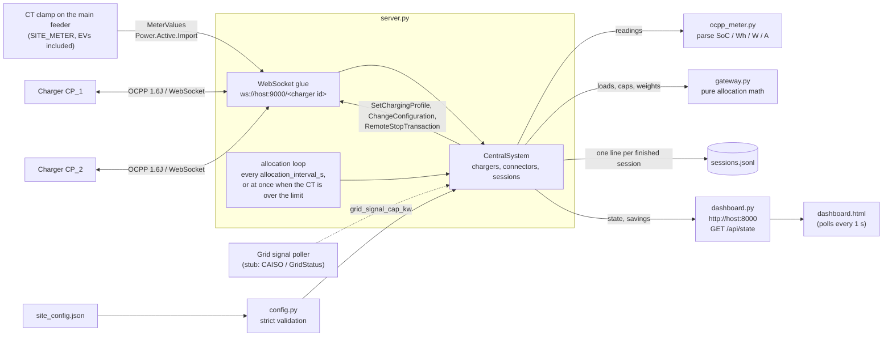

# edge-ocpp-router

An OCPP 1.6J central system that shares a building's spare electrical capacity among
EV chargers. A CT clamp on the main incoming feeder measures the whole site. From
that reading, the server works out what everything *other* than the EVs is drawing.
It then gives the EVs what is left, by priority, as `SetChargingProfile` limits. Cuts
go out immediately, and it never hands out power that a car might still be using.

Built for sites where the panel is the constraint: commercial buildings, parking lots,
fleet depots, and landlord/HOA buildings.

## Reference site

`site_config.json` describes a realistic small building: a small commercial or HOA
building with six Level-2 chargers in its parking area. The config records the physical
equipment, and the server refuses to start if a kW setting is more than that equipment
can carry.

| | Value | Where the number comes from |
|---|---|---|
| Utility transformer | 150 kVA | Pad-mount, sized above the service |
| Service | 208Y/120 V, 3-phase, 400 A main breaker (standard, 80 %-rated) | 208 × 400 × √3 = 144.1 kVA |
| Continuous capacity | 103.8 kW | 80 % of 144.1 kVA = 115.3 kVA (the transformer is larger), × 0.9 worst power factor |
| `panel_limit_kw` | **100 kW** | Below the continuous capacity |
| `safety_margin_kw` | **20 kW** | ≥ largest load step (15 kW HVAC compressor) + CT noise + CT accuracy |
| Usable for the building + EVs | 80 kW | 100 − 20 |
| Building load | 55 kW base, +15 kW when the HVAC compressor runs | → EV budget about 25 kW / 10 kW |
| Chargers | 6 × Level 2, 32 A at 208 V on 40 A breakers | 6.656 kW each, 40 kW if all ran flat out |
| `min_charger_kw` | 1.44 kW | 6.9 A at 208 V, above the SAE J1772 6 A minimum (1.248 kW) |

The six chargers could draw 40 kW, but the building only leaves 10–25 kW. That gap is
why this router exists: without it, the site would need a bigger service.

## Architecture



| File | Role |
|---|---|
| `server.py` | `CentralSystem` (all logic, no sockets) plus the WebSocket glue, allocation loop and grid poller. |
| `gateway.py` | Pure math: other-load estimate, EV budget, priority weights, capped weighted split, transition-safe limits, charging-profile messages. |
| `ocpp_meter.py` | Reads `meterValue → sampledValue` (and simple `{"soc": ..}` JSON) into fixed units. |
| `config.py` | Loads and strictly validates `site_config.json`. |
| `sim_chargers.py` | Simulated chargers (with battery physics) and a simulated main-feeder CT clamp. |
| `dashboard.py` / `dashboard.html` | JSON API and live web dashboard (asyncio HTTP, no web framework). |
| `demo.py` | One-process interactive demo: controller + simulated site + dashboard with demo controls. |

## Quick start

```bash
python3 -m venv venv
venv/bin/pip install -r requirements-dev.txt

# terminal 1
venv/bin/python server.py

# terminal 2
venv/bin/python sim_chargers.py
```

The simulator starts six chargers. They boot, accept the 0 W default for new sessions,
and their cars plug in at random moments over the first 20 s:

```
[CP_1 | 15.0% SoC] Default limit for new sessions: 0.0 W
...
[CP_1 | 15.0% SoC] Received limit: 6250.0 W
```

The building's base load is 55 kW, so the EV budget is 80 − 55 = 25 kW. The cars below 30 %
and the car without SoC get 6250 W each, the cars at 48 % and 67 % get 3125 W each, and the
85 % car waits (its 1.0 kW share is under the 1.44 kW minimum). Every 60 s the HVAC
compressor adds 15 kW. The budget then drops to 10 kW within one CT reading: the three
priority cars get 3333 W each and the others pause. When the compressor stops, they all
resume.

Between **16:00 and 21:00 site time** (the PG&E peak window), the budget is capped at
`peak_budget_cap_kw` (5.0 kW): the three priority cars get 1666 W each and the others wait.

At startup the server logs `waiting for the first CT reading from SITE_METER` (INFO)
until the simulator connects. It warns only if no reading has arrived after
`stale_after_s` (15 s), or if readings stop.

Run the tests (no internet needed; the end-to-end tests use loopback only):

```bash
venv/bin/pytest -q
```

## Live dashboard and interactive demo

```bash
venv/bin/python demo.py          # then open http://localhost:8000
```

`demo.py` runs the real controller, ten simulated chargers and a simulated CT meter in one
process, using `site_config.demo.json`. That file describes a mid-size commercial
building: 480 V 3-phase, a 1200 A main breaker and a 750 kVA transformer (675 kW
continuous at power factor 0.9), a 600 kW limit with a 120 kW safety margin, and 48 A /
208 V chargers (9.984 kW). The page refreshes every second and shows:

* **Demo controls:**
  * the building's non-EV load (0–550 kW)
  * a 150 kW HVAC spike lasting 30 s
  * the PG&E 4–9 PM peak window, which can be forced on or off
* **Power flow:** grid → main panel → building and EV chargers. A capacity bar shows the
  building load, the EV draw and the 120 kW safety margin against the 600 kW limit.
* **Estimated savings:** this month and this session, and the peak kW shaved right now.
* **One card per charger:**
  * SoC
  * priority tier
  * allocated limit
  * actual draw
  * status
  * plug-in time
* **Recent warnings and critical alerts.**

The demo controls change only the **simulated building**. The controller sees what the
simulated CT reports, exactly as on a real site. `server.py` serves the same dashboard,
read-only: on a live site the demo endpoints answer 404, so nothing on the network can
fake the building load. The page loads Tailwind from its CDN, so the browser needs
internet access for styling.

| Endpoint | Body | |
|---|---|---|
| `GET /` | | The dashboard page. |
| `GET /api/state` | | Site, telemetry, peak window, savings, chargers, alerts (JSON). |
| `POST /api/demo/load` | `{"kw": 420}` | Building non-EV load (demo only). |
| `POST /api/demo/spike` | | 150 kW for 30 s (demo only). |
| `POST /api/demo/toggle-peak` | none, or `{"active": true\|false\|null}` | Flip, force, or (`null`) follow the schedule (demo only). |

POSTs must be `Content-Type: application/json`. There is no TLS and no login: keep the
dashboard port on a trusted network.

### How savings are estimated

Savings are counted only while a peak window is in effect and the CT reading is fresh.
Each cycle compares the measured site load with the load the site **would** have drawn
unmanaged. "Unmanaged" assumes every charging car draws its charger's full rating
(`max_charger_kw`). A car that is full, tapered, or reports that it is not drawing counts
at its actual draw.

* **Demand charge avoided** = (highest 15-minute average peak-window demand unmanaged −
  the same, measured) × `peak_demand_rate_per_kw`.
  * Both maxima are this calendar month's, in site-local time.
  * Demand is averaged per 15-minute clock interval, as PG&E bills it.
  * The interval in progress counts with its average so far.
* **Energy moved off-peak** = kWh the EVs did not draw during the peak ×
  (`peak_energy_rate_per_kwh` − `offpeak_energy_rate_per_kwh`). This assumes that energy
  is delivered later at the off-peak rate.
* **This session** = energy savings since the server started. Demand charges are monthly,
  so they appear only under the month. Each charger card shows its own share, and the
  finished-session log records `peak_shifted_kwh`.
* All dollar amounts are rounded **down** to the cent.
* Savings live in memory, so a restart starts the month's count again.

These are estimates for demonstrating value, **not a bill**. Real demand charges depend on
the rate schedule (e.g. B-19 vs. B-20, seasonal rates, and max-demand charges outside
the peak), and on whether unmanaged cars would really have charged at full power then.

### Simulator options

| Option | Effect |
|---|---|
| `--cars CP_1:15,...,CP_5:none,CP_6:85` | Chargers and starting SoC. `none` = a J1772 car that reports no SoC (weighted by kWh delivered). |
| `--building-load-kw 55` | The building's base load. The simulated CT reports the total: base + HVAC + noise + **what the cars draw**. |
| `--hvac-kw 15 --hvac-period 60` | An HVAC compressor that runs 60 s on, 60 s off. |
| `--noise-pct 2` | Each CT reading varies by up to ±2 % of the base load. |
| `--arrival-spread 20` | Cars plug in at random times within 20 s of startup (0 = all at once). |
| `--charger-kw 6.656` | Each charger's hardware rating (defaults from `site_config.json`). |
| `--ct-interval 1` | Seconds between CT readings. |
| `--reject-tx CP_2` | CP_2 rejects TxProfile, so the server falls back to ChargePointMaxProfile. |
| `--reject-all CP_2` | CP_2 rejects every profile, so the server sends RemoteStopTransaction and raises a CRITICAL alert. |
| `--ct-dropout-after 10` | The CT goes silent after 10 s; 15 s later the budget drops to the 2.0 kW floor. |
| `--time-scale 600 --battery-kwh 5` | Speeds up charging to watch cars fill up and taper off. |

## How a cycle decides power

1. **Measure the other loads.** The CT clamp on the main feeder measures the whole site,
   **EVs included**. So: *other loads = CT reading − what the EVs drew at that instant*.
   The CT and the chargers report at different moments, so each car's draw is paired
   with the CT reading by time and bounded from below and above:
   * The car's last power reading at or before the CT reading is used. With none, the
     car counts as 0, because a car that only started afterwards is not in that reading.
   * A lower reading just afterwards is used instead (the car may have stopped by
     itself), unless a new limit was accepted in between. In that case the drop is the
     server's own cut, which the CT reading predates.
   * The value is capped by the limit in force at that instant. A car still ramping down
     after a cut only counts its new limit. With no known limit, it is capped at
     `max_charger_kw`, so a garbage value such as 1e9 W can't wipe out the other loads.
   * A car whose charger reports SuspendedEV/SuspendedEVSE counts as 0.
   * **The upper bound.** Right after a limit change, a car may or may not have followed
     yet, so its draw lies between its last reading and its new limit. That window is the
     J1772 response time (5 s) plus one meter-sample interval.

   The other loads are therefore known to lie in a band. The previous estimate is kept,
   **clamped into that band**:
   * A CT rise fully explained by our own raise changes nothing. Without this, the server
     would mistake its own raise for building load and cut the cars, and they would flip
     on and off every cycle.
   * A CT move the cars cannot explain moves the estimate at once.
   * When all readings are current, the band is a single value, so the estimate is exact
     with no lag.
   * A charger that never reports power stops widening the band once that window
     passes, so it cannot hide a real load increase. Its draw then counts as other load,
     which is the safe side.

   The result is rounded **up** to whole watts.
2. **Building budget** = `panel_limit_kw − other loads − safety_margin_kw`, never negative,
   rounded **down** to whole watts.
3. **Bad CT data.**
   * No reading yet, or one older than `stale_after_s` (15 s): the budget is held at
     `stale_floor_kw` (2.0 kW). That is neither 0 W, which can fault EVs, nor full power,
     which can trip breakers.
   * A **negative** reading means the clamp is installed backwards (or the site is
     exporting). Trusting it would hand the EVs the whole panel, so the budget is 0 and a
     CRITICAL alert is logged.
4. **Caps.** A live grid signal (`grid_signal_cap_kw`, no older than `max_age_s`) caps
   the budget. Without one (offline), the tariff `peak_windows` apply with
   `peak_budget_cap_kw`. The lower of the budget and the cap is used.
5. **Reserved power.** A charger that disconnects mid-session keeps its last limit
   reserved, because its profile is still in force on the charger. That lasts until it
   reconnects or `offline_session_timeout_s` passes. A charger that refused every limit
   has `max_charger_kw` reserved until its transaction stops.
6. **Priority.** If the car reports SoC: below 30 % → 3.0, below 80 % → 1.5, below 100 % →
   0.5, full → 0. If it reports no SoC: kWh delivered this session below 10 → 3.0,
   10–30 → 1.5, above 30 → 0.5.
7. **Split.** The budget is shared by weight in **exact integer watts**. Weights are
   Python `Fraction`s, so no binary floating-point error enters a share, and every share
   is rounded down. No car gets more than `max_charger_kw`, and any excess is
   redistributed. A share below `min_charger_kw` becomes 0 W and its power goes to the
   others, lowest priority first. Between equal weights it is first come, first served:
   the car that plugged in first keeps charging, and the choice does not flip between
   cycles.
8. **Taper reclaim.** A car that has been allowed to charge for `taper_grace_s` but
   draws under `taper_threshold_w` is capped at `min_charger_kw`. The freed power goes
   to the other cars, and the car gets its full share back as soon as it draws again.

## Throttling sharply without tripping a breaker

* **New cars start at 0 W.** When a charger boots or connects, the server installs a
  **TxDefaultProfile on connector 0 at 0 W**: every new session starts there, not at the
  charger's full hardware default. Plugging in triggers an immediate cycle, so the car
  gets its own limit within milliseconds. Without this, cars arriving together would all
  draw full power before their first limit arrived. In testing, six cars at once pushed
  the site 9 kW over the panel limit. The default has its own profile id and stack
  level, so it never replaces a per-car profile.
* **Cuts are immediate.** A cut is sent on the cycle it is computed, to all chargers in
  parallel. A charger still answering a previous message gets it on the next cycle;
  meanwhile, its old limit stays counted as committed. The only exception is cuts too
  small for the CT to resolve (below its accuracy, `ct_accuracy_pct`): they may be held,
  smallest first, as long as the total held across the **whole site** stays within that
  accuracy (800 W here). Anything bigger goes out at once, including any cut that stops a
  car. Otherwise every charger would get a message on every reading, chasing
  measurement noise.
* **Raises only from real headroom.** A charger only lowers its draw once it has
  accepted a new limit. Until then, each car is counted at its *committed* power: its
  accepted limit, any higher limit still in flight, or one that was sent and never
  answered. An unknown car counts as `max_charger_kw`. Raises are granted, highest
  priority first, only from headroom that exists while every car still draws its
  committed power. Moving power from car A to car B therefore takes two cycles: A's
  cut, then B's raise once A has confirmed. At no point can the worst case exceed the
  budget, plus at most the small cuts held within CT accuracy (below). The tests check this property over 20,000 random situations and through
  300 cycles of a busy site.
* **No waiting when the site is over.** A CT reading above `panel_limit_kw −
  safety_margin_kw` starts a cycle immediately instead of waiting for the next one.
  In the end-to-end stress test, the building load jumped randomly every 0.4 s. The
  overshoot never exceeded the size of the jump itself (the part no controller can
  prevent), and it lasted at most one car-reading interval. That's the case where a
  building jump coincides with one of the server's own raises and can't be told apart
  until the cars' next reading.
* **Less network chatter, safely.** A raise smaller than `min_increase_w` (100 W) is not
  sent, because holding the lower value is always safe. Small cuts follow the site-wide
  accuracy rule above. Unchanged limits are refreshed every `profile_refresh_s` (30 s).
  On the reference site with a noisy CT, this halved the limit messages, with no on/off
  flapping.
* **Sizing the safety margin.** A load that switches on between two CT readings
  overshoots by its own size before any controller can react. So `safety_margin_kw`
  must be at least the **largest single load step** (here, the 15 kW HVAC compressor)
  plus CT noise and accuracy. With a 10 kW margin and a 15 kW compressor, testing showed
  the site reaching 102.4 kW for one second. With 20 kW, it never passed 95 kW.
* **Fresh readings.** After each boot, the server sets the charger's
  `MeterValueSampleInterval` and `MeterValuesSampledData` (standard OCPP 1.6 keys), so
  power readings arrive often enough to pair with the CT. If a charger cannot sample
  SoC, the server asks again without it.
* **One message at a time.** Each charger has at most one of the server's CALLs
  outstanding, as OCPP-J requires.

## Sending limits, and what happens when a charger refuses

* A car with a transaction gets a **TxProfile** (with its `transactionId`). A car without
  a transaction gets a **TxDefaultProfile**. Limits are whole watts, rounded down.
* **Rejected** (or `NotSupported`, or a CALLERROR): the server retries once with a
  **ChargePointMaxProfile** (connector 0, stackLevel 0, Absolute). If it is accepted, that
  charger is limited through ChargePointMax from then on, until it reboots.
* **Still rejected**: the server sends **RemoteStopTransaction** and logs a `CRITICAL ALERT`.
  If there is no transaction to stop, or the stop is refused, the alert says manual
  intervention is required.
* **No answer** within `call_timeout_s` is not treated as a refusal. The limit is retried
  next cycle, and is counted as possibly in force in the meantime.
* **Accepted but ignored.** A charger that accepts a limit but still draws more than it
  10 s later (SAE J1772 gives the car 5 s to follow) is logged as an error once. The site
  stays protected, because its excess shows up in the CT reading as other load.

## Sessions

A session runs from plug-in to unplug (`Available`). Plug-in is detected from
`StatusNotification` Preparing/Charging/SuspendedEV/SuspendedEVSE, `StartTransaction`, a
first SoC reading, or `MeterValues` for a running transaction the server had not seen.
For each session, the server tracks plug-in time, duration, transaction start/stop,
kWh delivered (from `meterStart`/`Energy.Active.Import.Register`/`meterStop`) and start
and end SoC. Each finished session is appended as one JSON line to `session_log_path`.

## Configuration (`site_config.json`)

Every key is required, except the three tariff rates. Give all three or none; without
them, savings are shown in kW and kWh only. An unknown key, a wrong type or an
out-of-range value stops the server at startup with a message naming the key. The rate
bounds catch cents typed as dollars.

| Key | Default | Meaning |
|---|---|---|
| `site.panel_limit_kw` | 100.0 | Most the whole site may draw **continuously**. Checked against `electrical_service`. |
| `site.safety_margin_kw` | 20.0 | Kept free below the limit (usable: 80 kW). At least the largest load step + CT accuracy. |
| `site.site_meter_id` | `SITE_METER` | Connection id of the main-feeder CT meter. |
| `site.timezone` | `America/Los_Angeles` | Site time for the peak windows (DST handled). |
| `electrical_service.voltage_v` / `phases` | 208 / 3 | The service. |
| `electrical_service.main_breaker_a` | 400 | Main breaker rating. |
| `electrical_service.breaker_100_percent_rated` | false | A standard breaker carries 80 % continuously; a 100 %-rated one carries 100 %. |
| `electrical_service.transformer_kva` | 150 | Utility transformer. |
| `electrical_service.min_power_factor` | 0.9 | Worst expected power factor: breakers limit current (kVA); the CT reports kW. |
| `chargers.voltage_v` / `max_current_a` | 208 / 32 | Charger supply and rating; `max_charger_kw` may not exceed their product. |
| `chargers.max_charger_kw` | 6.656 | Most one car may get (32 A × 208 V). |
| `chargers.min_charger_kw` | 1.44 | Smallest limit sent other than 0. Must be ≥ 6 A × `voltage_v` (SAE J1772). |
| `chargers.min_increase_w` | 100.0 | Raises smaller than this are not sent (cuts always are). |
| `chargers.taper_threshold_w` | 100.0 | Below this measured draw, a car counts as tapered. |
| `chargers.taper_grace_s` | 30.0 | Ramp-up time before a car can count as tapered. |
| `chargers.offline_session_timeout_s` | 300.0 | How long an offline charger's limit stays reserved. |
| `telemetry.stale_after_s` | 15.0 | CT reading age after which the budget drops to the floor. |
| `telemetry.stale_floor_kw` | 2.0 | Total EV budget on stale telemetry (~9.6 A at 208 V). |
| `telemetry.ct_accuracy_pct` | 1.0 | The CT meter's accuracy class. Cuts within it may be held, site-wide (800 W here). |
| `tariff.peak_windows` | 16:00–21:00 | Daily windows, site time; `end` < `start` wraps past midnight. |
| `tariff.peak_budget_cap_kw` | 5.0 | EV budget cap inside a peak window. |
| `tariff.peak_demand_rate_per_kw` | 25.0 | *Optional.* $ per kW of monthly peak-window demand (0–200). |
| `tariff.peak_energy_rate_per_kwh` | 0.42 | *Optional.* $ per kWh inside a peak window (0–5). |
| `tariff.offpeak_energy_rate_per_kwh` | 0.18 | *Optional.* $ per kWh outside it; not above the peak rate. |
| `grid_signal.enabled` | false | Run the grid signal poller. |
| `grid_signal.poll_interval_s` | 60.0 | Seconds between polls. |
| `grid_signal.max_age_s` | 300.0 | Older signals are ignored (tariff windows apply). |
| `server.host` / `server.port` | localhost / 9000 | Where the server listens. |
| `server.dashboard_port` | 8000 | Dashboard and JSON API (same host); must differ from `port`. |
| `server.allocation_interval_s` | 2.0 | Seconds between allocation cycles. |
| `server.profile_refresh_s` | 30.0 | Re-send an unchanged limit this often. |
| `server.call_timeout_s` | 10.0 | Wait this long for a charger's reply. |
| `server.meter_sample_interval_s` | 5 | `MeterValueSampleInterval` pushed to chargers (whole seconds, below `stale_after_s`). |
| `server.session_log_path` | `sessions.jsonl` | Finished-session log (relative to the config file); `null` to disable. |

## Codes, standards and policies this design assumes

This is engineering guidance, not legal advice. The authority having jurisdiction
(AHJ), the utility and a licensed electrician decide what applies to a given site.

* **EV charging is a continuous load (NEC Article 625).** A standard (non-100 %-rated)
  breaker may carry at most 80 % of its rating continuously. The config enforces this:
  `panel_limit_kw` may not exceed the service's continuous capacity, computed from
  `electrical_service`.
* **Load management (NEC 625.42, Article 750).** The NEC allows an automatic load
  management system to limit the EV load used in service and feeder calculations. The
  AHJ may require the system to be listed. UL 916 covers energy management equipment,
  and the chargers themselves are typically listed to UL 2594.
* **SAE J1772.** The minimum pilot current is 6 A. The config refuses a `min_charger_kw`
  below 6 A at the chargers' voltage. An EV has 5 s to follow a new pilot. That is why
  overdraw is only reported after 10 s, and why the other-loads band (above) stays open
  for 5 s plus one meter sample.
* **Selling energy by the kWh.** Selling energy by the kWh needs type-approved EVSE metering
  (NIST Handbook 44, §3.40 "Electric Vehicle Fueling Systems"; enforced in California by
  the Division of Measurement Standards). The kWh this router records come from charger
  telemetry for load management. **Do not bill from them.**
* **Privacy.** `sessions.jsonl` contains `idTag`s and plug-in times, which can identify
  drivers. Under California's CCPA/CPRA, that log needs a retention and access policy.
* **Utility tariffs.** The PG&E peak window (16:00–21:00) is configuration. Check it
  against the site's actual rate schedule.

## Assumptions and limits

* **The CT is on the main feeder, upstream of the chargers**, so it measures the EVs too.
  If it were downstream (EVs excluded), the EV draw would be subtracted from a reading
  that never contained it, overstating the free capacity.
* **Phase balance is not managed.** Breakers trip per phase, but the budget is in total
  kW. On a 3-phase service, wire single-phase chargers across rotating phase pairs, and
  size `safety_margin_kw` for the worst imbalance.
* **On-site generation (solar) is not supported.** A negative CT reading is treated as a
  fault (EV budget 0), as described above.
* **The grid signal poller is a stub.** It makes no network call and reports "no signal",
  so the tariff windows apply. To use a real signal, give `grid_signal_poller` an async
  `fetch` that returns a cap in kW (or `None`), or construct `CentralSystem` with
  `grid_signal_cap_kw=`.
* **Every `idTag` is accepted.** Driver authorization is outside this router's scope.
* **Limits are sent in watts** (`chargingRateUnit: "W"`). Some AC chargers only accept
  amps. Such a charger would reject the profile, which triggers the fallback and
  escalation path above.
* **A charger's limit is unknown until it accepts one.** Until then, it is counted at
  `max_charger_kw`. A charger whose hardware default is higher draws more until its first
  limit lands, normally within one cycle. Its excess shows up in the CT reading.
* **State is in memory and the server is a single process.** After a restart, running
  transactions are adopted from the chargers' next `MeterValues` (OCPP chargers include
  the `transactionId`), and new plug-ins are picked up from `StatusNotification`.
